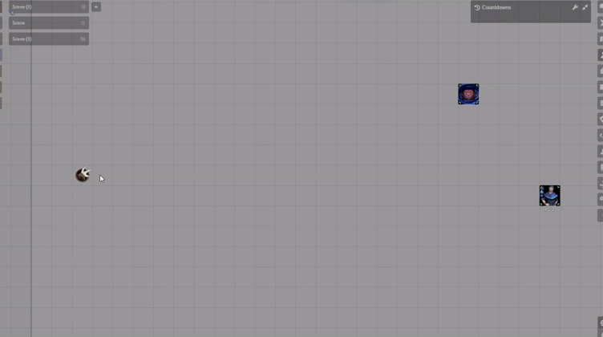
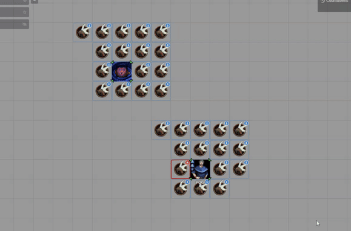

# Daggerheart: Horde

Putting thirty zombies on the map is easy. Moving them one by one every round, and marking HP on each of them, is where the fight slows down.

Daggerheart: Horde turns one horde token into dozens of tokens with one click. Then you move the whole group with a single button, and HP marked on any of them counts for the whole horde, removing tokens from the map as it goes.





[](https://buymeacoffee.com/mestredigital) [](https://mestredigital.online/pages/projetos-en)

## What it does

| Action | What happens |
|---|---|
| Multiply | One horde token becomes many copies, spread in a spiral around the original |
| Move | The horde walks toward the tokens you target and surrounds them instead of stacking on them |
| Dissolve | All copies are deleted and the leader token stays |
| Stat sync | HP or Stress changed on one member is copied to every other member of the horde |
| Visual markers | The leader has a crown and the other members have a pawn badge |
| Dashboard | One window lists every active horde, finds its leader on the map, manages members and dissolves groups |

It works on square-grid and gridless scenes. Hexagonal grids are not supported yet.

## How to use it

The horde actions are for the GM. The button only appears on adversaries whose type is Horde.

### Step 1: set up the horde actor

The module reads two values from the adversary:

- `system.typeData.hordeHP`, the number of creatures for each point of HP. This is the "Horde (X/HP)" value of the stat block.
- `system.resources.hitPoints.max`, the horde's HP.

The number of tokens is the first value times the HP the horde still has (maximum HP minus the HP already marked), counting the original token. A horde with 5 creatures per HP and 6 HP, with no HP marked, becomes 30 tokens.

### Step 2: multiply

1. Right-click the horde token on the canvas.
2. In the Token HUD, click the chess rook icon (**Horde Actions**).
3. Click **Multiply Horde**.

The copies come out of the original token and walk to their places in a spiral around it.

Before copying, the original token is unlinked from the actor, so each token has its own data.

### Step 3: move the horde

1. Target one or more enemy tokens as the GM (with the target icon, or press `T` while hovering over the token).
2. Open **Horde Actions** on any token of the horde.
3. Choose how far it moves:

| Button | What happens |
|---|---|
| **Move Close** | Each token advances toward the target by Close range, 30 in the scene's own distance units (6 cells on a standard 5 ft grid) |
| **Move Far** | Each token advances by Far range, 60 in the scene's own distance units (12 cells on a standard 5 ft grid) |
| **Move All** | Every token walks the full path and takes a place around the target, never on top of another token |

The tokens find their way with A\* pathfinding and do not cross walls. When there is more than one target, the horde splits between them, each token going to the nearest one, and forms a ring around each target.

### Step 4: mark damage on any token

When a player hits the horde, mark HP or Stress on any member. The module copies the new value to every other member of the horde, so you never update thirty tokens by hand.

The number of tokens follows the HP:

- Each point of HP marked removes as many tokens as the horde has creatures per HP. The token that was hit goes first, then the ones closest to it.
- When the marked HP reaches the maximum, the whole horde is removed from the map.
- If you clear HP, the tokens come back near the leader, up to the horde's original size.

### Step 5: dissolve when the fight is over

When the encounter ends, or the horde retreats, open **Horde Actions** and click **Dissolve Horde**.

Every member token is deleted, the leader token stays on the map, and the group is forgotten.

You can also dissolve a horde from the Dashboard, which helps when more than one horde is active.

## The dashboard

Open it with the **Dashboard** button in any **Horde Actions** window, or in **Game Settings** with the **Manage Hordes** button.

The Dashboard lists every active horde in the world. For each one it shows:

- the group number and the leader's name;
- how many members it has;
- **Find**, which moves the camera to the leader token and selects it;
- **Members**, which opens the list of every token in the horde, where you can make one the leader or remove it from the horde;
- **Dissolve**, which asks for confirmation and then deletes every member except the leader.

## Visual markers

With thirty tokens on the map, small badges show which is which:

- the horde leader has a crown badge and a red border;
- the other members have a pawn badge and a blue border.

Only the GM sees them, and they update as tokens join or leave the horde.

## Translations

The module ships in English. To translate it, open an [issue](https://github.com/brunocalado/dh-horde/issues) and attach a translated copy of [lang/en.json](lang/en.json), with the code of your language (for example `fr`, `de` or `pt-BR`). I add the file to the module in the next update. To update a translation later, do the same with the new file.

## Installation

Install it from the Foundry VTT module browser, or use this manifest link:

```
https://github.com/brunocalado/dh-horde/releases/latest/download/module.json
```

It needs Foundry VTT v14 and the Daggerheart system, version 2.10.5 or later.

## ⚖️ Credits & License

* **Code License:** GNU GPLv3.

* **banner.webp and thumbnail.webp:** [Link](https://pt.pngtree.com/freepng/tiny-spartans-might-in-miniature-form_23041278.html)

* **Disclaimer:** This module is an independent creation and is not affiliated with Darrington Press.


# 🧰 My Daggerheart Modules

| Module | Description |
| :--- | :--- |
| 💀 [**Adversary Manager**](https://github.com/brunocalado/daggerheart-advmanager) | Scale adversaries instantly and build balanced encounters. |
| 🖼️ [**Art Mapper**](https://github.com/brunocalado/dh-assets) | Automatically assigns artwork to system compendiums, actors, tokens, and custom module content — keeping your visuals organized and up to date. |
| 🐉 [**Colossus**](https://github.com/brunocalado/dh-colossus) | Manage massive multi-part boss encounters with independent HP per part and a single shared stress pool. |
| 📦 [**Containers**](https://github.com/brunocalado/dh-containers) | Group inventory items into collapsible containers — pouches, chests, backpacks — to declutter character sheets. |
| 💥 [**Critical**](https://github.com/brunocalado/daggerheart-critical) | Animated criticals. |
| 💠 [**Custom Stat Tracker**](https://github.com/brunocalado/dh-new-stat-tracker) | Add custom trackers to actors. |
| ☠️ [**Death Moves**](https://github.com/brunocalado/daggerheart-death-moves) | Enhances the Death Move moment with a dramatic interface and full automation. |
| 📏 [**Distances**](https://github.com/brunocalado/daggerheart-distances) | Visualizes combat ranges with customizable rings and hover calculations. |
| 📦 [**Extra Content**](https://github.com/brunocalado/daggerheart-extra-content) | Homebrew content pack. |
| 😱 [**Fear Tracker**](https://github.com/brunocalado/daggerheart-fear-tracker) | Adds an animated slider bar with configurable fear tokens to the UI. |
| 🧟 [**Horde**](https://github.com/brunocalado/dh-horde) | Explode single horde tokens into dozens of individual tokens and manage their movement and stats automatically. |
| 🎁 [**Mystery Box**](https://github.com/brunocalado/dh-mystery-box) | Introduces mystery box mechanics for random loot and surprises. |
| ⚡ [**Quick Actions**](https://github.com/brunocalado/daggerheart-quickactions) | Quick access to common mechanics like Falling Damage, Downtime, etc. |
| 📜 [**Quick Rules**](https://github.com/brunocalado/daggerheart-quickrules) | Fast and accessible reference guide for the core rules. |
| 🤖 [**Resource Macros**](https://github.com/brunocalado/daggerheart-fear-macros) | Automatically executes macros when the Fear or Hope resources change. |
| 🎲 [**Stats**](https://github.com/brunocalado/daggerheart-stats) | Tracks dice rolls from GM and Players. |
| 🧠 [**Stats Toolbox**](https://github.com/brunocalado/dh-statblock-importer) | Import actors using a statblock. |
| 🛒 [**Store**](https://github.com/brunocalado/daggerheart-store) | A dynamic, interactive, and fully configurable in-game store. |
| 🔍 [**Unidentified**](https://github.com/brunocalado/dh-unidentified) | Obfuscates item names and descriptions until they are identified by the players. |
| 🌌 [**Void**](https://github.com/brunocalado/the-void-unofficial) | Unofficial module that brings The Void playtesting content — experimental classes, subclasses, ancestries, communities, adversaries, loot, weapons, and more. |

# 🗺️ Adventures

| Adventure | Description |
| :--- | :--- |
| ✨ [**I Wish**](https://github.com/brunocalado/i-wish-daggerheart-adventure) | A wealthy merchant is cursed; one final expedition may be the only hope. |
| 💣 [**Suicide Squad**](https://github.com/brunocalado/suicide-squad-daggerheart-adventure) | Criminals forced to serve a ruthless master in a land on the brink of war. |
